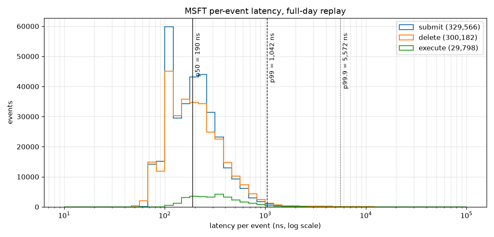
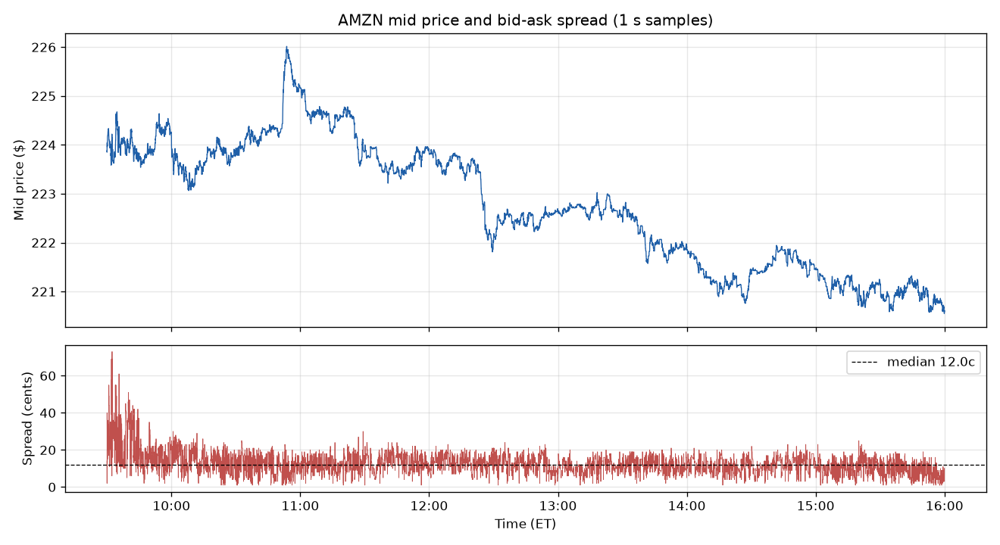
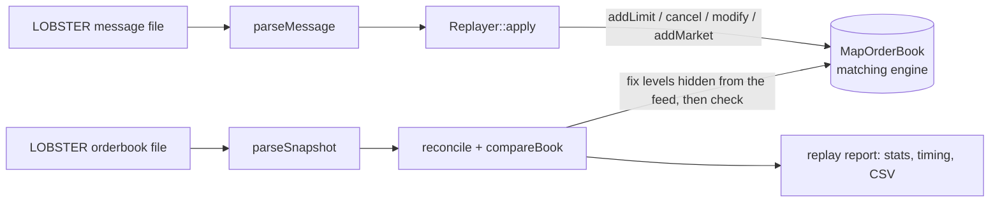

# Limit Order Book & Matching Engine (C++20)

A price-time priority limit order book and matching engine, validated against a full day of real
NASDAQ data: **938,511 LOBSTER events across AMZN and MSFT, with the book matching the exchange's
real top 10 levels on 100% of rows**. Replays at **~4.5 M events/s** (p50 ~150–190 ns per event).

- Limit, market, cancel, modify (keeps or loses priority, like real exchanges) and cancel/replace
- O(1) cancel via an order-id index into per-level FIFO queues
- Integer tick prices (`int64_t`), never `double`
- LOBSTER parser (`std::from_chars`, ~1.3–1.8 M lines/s) and a replayer that drives the book from
  real exchange events and checks it against the exchange's own snapshots after every event
- Google Benchmark micro-benchmarks, per-event latency percentiles, 78 GoogleTest tests

## Results

| | AMZN 2012-06-21 | MSFT 2012-06-21 |
|---|---|---|
| Events replayed | 269,747 | 668,764 |
| Rows where all 10 levels match the real book | **100.00%** | **100.00%** |
| Executions routed through the matching engine | 8,346 | 28,442 |
| Replay throughput (Google Benchmark, median) | 4.6 M events/s | 4.4 M events/s |
| Latency per event p50 / p99 / p99.9 | 150 / 631 / 1,413 ns | 190 / 1,042 / 5,570 ns |
| Volume / VWAP | 810,754 sh / $222.63 | 10,824,421 sh / $30.50 |
| Time-weighted spread | 7.4 ¢ | 1.0 ¢ |





The spread is widest just after the 9:30 open and narrows within the first half hour: uncertainty
is highest at the open, so market makers quote wider.

## Architecture



```
include/  types.hpp, order.hpp, trade.hpp   core value types (Price, Qty, Order, Trade)
          i_order_book.hpp                  IOrderBook interface (every book implements it)
          map_order_book.hpp                std::map + std::list book with O(1) cancel
          lobster.hpp, replayer.hpp         LOBSTER parser, replayer and validation
src/      map_order_book.cpp, lobster.cpp, replayer.cpp
          main.cpp          scripted demo (orderbook_app)
          replay_main.cpp   full-day replay + validation (replay)
bench/    book_bench.cpp    Google Benchmark micro-benchmarks (bench)
          latency_main.cpp  per-event latency percentiles (latency)
tests/    78 GoogleTest tests
scripts/  download_data.ps1, plot_spread.py, plot_latency.py
```

## Design decisions

| Decision | Why |
|---|---|
| `std::map<Price, std::list<Order>>` per side | Sorted levels give the best price at `begin()` in O(1); a list per level is a FIFO queue (price-time priority) |
| `unordered_map<OrderId, Locator>` index | Stores each order's side, price and list iterator: cancel and modify are O(1) with no search. `std::list` iterators stay valid when other orders come and go, which is why levels are lists and not vectors |
| One `matchAgainst` template for both sides | Bids (`std::greater`) and asks (`std::less`) are different map types; `key_comp()` makes one crossing check work for both |
| Modify down keeps priority, modify up loses it | Same as real exchanges: otherwise you could join the queue small and grow later, jumping everyone who arrived in between |
| Trades at the resting order's price | Standard exchange rule: the maker sets the price |
| Integer ticks for price, integer ns for time | Floating point can't hold most decimals exactly, so two equal prices could land on different levels |
| `IOrderBook` interface | Tests, replay and benchmarks run unchanged against any book (a tick-indexed vector book is next) |
| `std::pmr::unsynchronized_pool_resource` for all nodes | Order, level and index nodes reuse freed memory without locking instead of going to the heap: 15–30% faster everywhere (below) |

## Replaying real data: how 100% was reached

LOBSTER gives two files per stock-day: every order event (message file) and the real top 10
levels after each event (orderbook file), so the book can be checked after every single event.
Executions are replayed as market orders through the engine whenever the executed order is first
in its queue, which also checks price-time priority against real fills.

The first replay matched the best bid/ask on only 17% of rows. Fixing it from the first divergence
each time uncovered three properties of the data:

1. **Orders resting before 9:30** aren't in the message file. They are seeded from the first
   snapshot as synthetic orders.
2. **A level-10 message file only contains events inside the top 10 levels**, so an order that
   drifts to level 11 can be cancelled without a message and becomes a phantom. After each event,
   `reconcile()` fixes only the levels that were outside the previous snapshot's window, the only
   ones that could have changed unseen. Levels that were visible are never touched, so they still
   test the engine honestly (there is a test for exactly that).
3. **Events for orders never seen** (pre-open, or submitted out of view) are applied to their
   price level. When the data doesn't say which order lost shares, the replayer prefers orders that
   have been out of view, with an exact size match first. A later Delete reveals the order's true
   remaining size, which corrects any wrong guess.

Best bid/ask match went 17% → 46% → 92% → 98.7% → 100%. MSFT, which played no part in the
debugging, then matched 100% on the first run.

In 15 of 8,974 AMZN executions and 718 of 29,798 MSFT executions, the exchange filled a newer order
while an older visible one at the same price stayed. A pure price-time book can't reproduce that
(self-match prevention is one likely cause; the data doesn't identify firms). The replayer counts
these and applies the fill directly, so the book still matches.

## Benchmarks

AMD Ryzen 7 6800H (8 cores, boost on), 16 GB, Windows 11, MSVC 19.44 Release (`/O2`), single
thread. Medians of 5 repetitions. Laptop timings move ±20% between runs, so compare rows within a
column, not across separate runs.

| Operation (book depth) | Before pool | With pool |
|---|---|---|
| Add resting limit order (100 levels) | 209 ns | 147 ns |
| Cancel resting order (100 levels) | 306 ns | 223 ns |
| Market order filling 1 order | 485 ns | 356 ns |
| Mixed flow (50% add, 45% cancel, 5% market) | 230 ns | 181 ns |
| Full-day replay, AMZN (269,747 events) | 79.7 ms | 60.9 ms |
| Full-day replay, MSFT (668,764 events) | 201 ms | 171 ms |

Other optimisations, each measured back to back against the previous build:

| Change | Result | Kept? |
|---|---|---|
| Pool allocator for list, map and hash nodes | 15–30% faster on every benchmark | yes |
| Replayer: one index lookup per event instead of up to four | 1–8% faster replay in 6 of 6 paired runs | yes |
| `reserve()` the order index up front | faster in 3 paired runs, slower in a 4th: within noise | kept as an optional constructor |
| Whole-program optimisation (`/GL` + `/LTCG`) | no consistent difference | reverted |

**Latency method.** `latency.exe` times every `Replayer::apply()` with the CPU's time-stamp counter
(`__rdtsc`, calibrated against `steady_clock`; on Windows `steady_clock` only ticks every 100 ns).
The timer itself adds ~10 ns per sample. Reading the snapshot file and `reconcile()` run between
events, outside the timed region, so every timed event runs against the exact real book.

## Build and run (Windows)

Requires Visual Studio 2022 (MSVC, CMake) and vcpkg with `VCPKG_ROOT` set; gtest and benchmark are
installed automatically from `vcpkg.json`. Run from a Developer PowerShell for VS 2022:

```powershell
cmake --preset msvc
cmake --build --preset release
ctest --preset release                          # or build\Release\tests.exe

build\Release\orderbook_app.exe                 # scripted demo: orders, trades, book after each step

powershell -ExecutionPolicy Bypass -File scripts\download_data.ps1   # ~270 MB into data\
build\Release\replay.exe  data\MSFT_2012-06-21_34200000_57600000_message_10.csv data\MSFT_2012-06-21_34200000_57600000_orderbook_10.csv --csv data\msft_spread.csv
build\Release\latency.exe data\MSFT_2012-06-21_34200000_57600000_message_10.csv data\MSFT_2012-06-21_34200000_57600000_orderbook_10.csv --csv data\latency_msft.csv
build\Release\bench.exe

python scripts\plot_spread.py  data\msft_spread.csv  docs\msft_spread.png  --title MSFT
python scripts\plot_latency.py data\latency_msft.csv docs\latency_msft.png --title MSFT
```

Sample output (`replay.exe`, MSFT):

```
Messages    668764 replayed (+1 used to seed)
  submit    329566
  cancel    5602 partial, 300182 full
  execute   29798 visible, 3616 hidden
  cancel-to-trade ratio  9.15

Volume      10824421 shares (9887669 visible, 936752 hidden)
VWAP        $30.4982
Avg spread  $0.0123 per event, $0.0101 time-weighted

Validation vs LOBSTER orderbook file (668764 rows)
  best bid/ask match   100.00%
  all 10 levels match  100.00%
  engine trades        28442
  priority mismatches  718
  dropped messages     0
  unexpected crosses   0
```

## Data

Sample data from [LOBSTER](https://lobsterdata.com) (NASDAQ, 21 June 2012, level 10), free for
research and education. LOBSTER's site now requires an account to download samples, so
`scripts/download_data.ps1` fetches the same files from public GitHub mirrors. The CSVs are not
committed.

## Next

- Tick-indexed vector book (`std::vector` of levels, bitset for best price, order object pool),
  benchmarked against the map book through the same `IOrderBook` tests
- Multithreaded pipeline: feed parser and matching engine on separate threads with a lock-free queue
